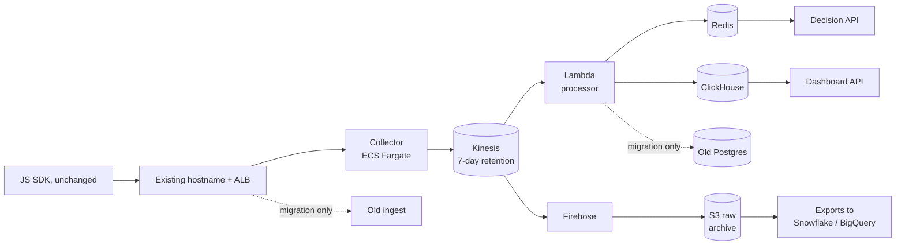

# Engineer 004: Real-Time Analytics Pipeline

**Raj Lakhani** · Brief version: 2026-07 · [Observed] Fixture `fixtures/event_sample.jsonl`, `shasum -a 256` = `448b6db3c2708ff2a5244a596aa2c6ddb2bbf9644478c56a72e96c127e784bf2`

**Artifact:** https://github.com/coding-island-js/beat-claude-engineer-004-raj (public, no login). Run `python run_fixture.py`. Python 3.9+, standard library only, nothing to install.

## Written answer

### The bottom line

This is not a big data problem. [Estimated] 50M events a day is 579 events per second on average and 5,787 per second at the 10x spike. That fits on a few small machines. The real problem is that the current system can lose an event after it accepted it, and nobody can prove the counts.

So the design does four things. It says "accepted" only after the event is in a durable log. It processes from that log, so a crash replays instead of losing. Every step is idempotent, so a replay never double counts. And a reconciler accounts for every row, so "accurate" is a test that passes or fails.

[Estimated] It costs about $3,500 a month, 7% of the $50K ceiling (`cost/cost_report.md`). Money is not the constraint. Two engineers are. So every choice below picks the option two people can run.

I built the riskiest part and ran it, on one PC, with the fixture and a 10x spike, hard-killed twice mid-run. [Observed] Zero events lost and zero double counted, in every run (`results/loadtest_300x10_b1.json`, `results/loadtest_579x10_b1.json`, `results/loadtest_579x10_b10.json`).

### 1. Architecture



The collector validates, stamps `received_at`, scrubs PII, and answers success only after Kinesis acks. The collector also counts every success it sends, per tenant per minute. The reconciler compares those receipts with ClickHouse and S3. The deletion job touches Redis, ClickHouse, S3 and exports.

| Piece | Choice | Rejected, and why |
|---|---|---|
| Intake | Collector on ECS Fargate, Node, behind the existing hostname. Same URL, same payload, both SDK shapes. | API Gateway or per-request Lambda: every beacon becomes a billed call. |
| Durable log | Kinesis Data Streams, provisioned. | Kinesis on-demand is cheaper here, but [Benchmarked] AWS says it absorbs only double the previous 30-day peak and can throttle when traffic more than doubles within 15 minutes ([AWS docs](https://docs.aws.amazon.com/streams/latest/dev/how-do-i-size-a-stream.html)). A 10x spike breaks that. MSK or self-run Kafka is a second job for a two-person team. SQS has no replay. |
| Processing | Lambda on the Kinesis stream, 1s batching window, bisect on error, failed batches to S3. | Managed Flink. The required rules are counts with a time limit, not session windows. I add Flink when a feature needs ordered multi-step sequences. |
| Analytics store | ClickHouse, ReplicatedReplacingMergeTree, `ORDER BY (tenant_id, toDate(event_time), event_id)`, plus per-minute rollup views. ClickHouse Cloud if procurement allows, self-run EC2 is the priced fallback. | Postgres: the team knows it, but it is a row store and the current system already falls over. Redshift: 500 tenants refreshing live dashboards is a concurrency problem. Timestream: weak at per-user drill-down. [Benchmarked] PostHog runs product analytics on this exact table engine ([PostHog docs](https://posthog.com/docs/how-posthog-works/clickhouse)). |
| Hot state | ElastiCache Redis, already in the stack. Dedupe keys with a 24h TTL. Per-visitor counters. | DynamoDB: fine, but a second new service. |
| Archive | Firehose to S3. The source for replay, export and backfill. | Lambda writing S3 itself: couples raw durability to the processor. |

**Event shape.** `tenant_id` comes from the write key, never the payload. The server adds `received_at`, `schema_version` and `flags` to what the client sends. `event_time` is the client `ts` if it is sane, else `received_at`. Old SDK field names are mapped at intake forever.

**Identity.** Any event that carries both ids writes a link (tenant, anonymous_id, user_id). An unverified privacy request does not, because anyone can send one. Queries stitch through the link table at read time. History is never rewritten. So a deletion removes a link, not every event. One anonymous id linked to two users means a shared device. Those are not merged.

### 2. Scale, reliability and the fixture

**Sizing.** [Estimated] Peak 5,787 events/s at an [Assumed] 1 KB each is 5.7 MB/s. [Benchmarked] A shard takes 1,000 records/s or 1 MB/s of writes ([AWS quotas](https://docs.aws.amazon.com/streams/latest/dev/service-sizes-and-limits.html)). That is 6 shards. I run 12 for uneven keys. Black Friday gets a planned resize the week before. ClickHouse: [Assumed] 100 of 500 tenants with a dashboard open, refreshing every 5 s, is 20 queries/s. They read per-minute rollups, not raw events, so two 8-vCPU replicas have room.

**Delivery guarantee, stated exactly.** SDK to Kinesis is at-least-once. The collector answers success (HTTP 202) only after Kinesis acks. Otherwise it answers HTTP 503 and the SDK retries. [Observed] evt-0002 arrives twice, 7.4 s apart, with the same body. That looks like an SDK retry, but a proxy replay would look the same, so weeks 1-2 confirm it in the SDK source. After Kinesis, duplicates die in two layers. The Lambda drops any (tenant_id, event_id) seen in Redis in the last 24 hours. Then ReplacingMergeTree collapses anything that slips through, and live queries read today's partition with `FINAL`. A retried batch reuses its ClickHouse insert dedup token. The prototype gets exactness from one SQLite transaction. AWS has no such transaction across Redis and ClickHouse, so there the two layers do that job and the reconciler proves it. Personalization counters can lose one increment if a crash lands between the Redis gate and the increment. I accept that. Dashboards never read those counters.

**Overload order.** Kinesis holds 7 days, so nothing upstream has to drop. Under load, exports pause first. Then dashboard freshness slips while lag grows. Then personalization serves last-known state. Intake never drops.

**What the prototype proved.** Same contract, built small, with the one difference named above: a CRC-checked append-only log with group-commit fsync stands in for Kinesis. SQLite commits rows, rollups, the outcome ledger and the offset in one transaction. Each run hard-kills the processor mid-spike and the intake later. [Observed] One Windows PC, 32 logical CPUs, Python 3.12, files in `results/`:

| Run [Observed] | Events | Accept p99 in spike, from send schedule | Event to queryable | Lost | Double counted |
|---|---:|---:|---:|---:|---:|
| 300/s, spike 3,000/s, 1 per request | 75,000 | 23.7 ms | p95 82 ms (spike 97 ms), max 3.4 s (crash) | 0 | 0 |
| 579/s, spike 5,790/s, 1 per request | 144,672 | queued: p95 8.5 s behind | p95 176 ms (spike 164 ms), max 3.8 s | 0 | 0 |
| 579/s, spike 5,790/s, 10 per request | 144,480 | 18.9 ms | p95 115 ms (spike 734 ms), max 3.8 s | 0 | 0 |

The middle row is the honest one. [Observed] One Python intake process saturates below 5,790 requests/s. It queued and lost nothing, but it fell behind. So production intake scales by tasks, and the [Assumed] 1,000 requests/s per task in the cost model is deliberately below what one process did here. These runs prove the mechanics. They do not prove AWS throughput.

**The fixture, class by class.** [Observed] `python run_fixture.py` catches all of these, cites the line, and fails if any row is unexplained (`results/fixture_report.md`):

| Class | Rows [Observed] | What the pipeline does |
|---|---|---|
| Retry duplicate | evt-0002 (lines 2 and 5) | Same id and content hash. Counted once. |
| Truncated JSON | evt-0020 (line 21) | Raw bytes kept in quarantine and counted. 400. Not auto-repaired. |
| No tenant | evt-0011 | Quarantined. Never guessed from the URL. |
| Old SDK shape | evt-0009 | `pageview`, `timestamp`, `page_path`, `ref` mapped. No `received_at`, so flagged. |
| Client clock ahead | evt-0005 (47.2 s), evt-0006 (65 min) | Server time used, client ts kept. |
| Impossible future | evt-0016 (a year ahead) | Server time used. Never creates a 2027 bucket. |
| PII in properties | evt-0007 (email, phone) | Keyed hash at intake, before the log. The raw email is on no disk (a test checks). |
| Bot burst | evt-0012 to 0015 | 4 page views in 64 ms. Excluded from dashboards and segments, earlier counts reversed. |
| Deletion request in the stream | evt-0017 | Queued as `pending_verification`. Not executed. |
| Client-computed count | evt-0019 `count_today: 3` | Not trusted. Segments use server-counted events only. |
| Identity | evt-0003, 0008, 0022 | anon-9f2 to u-5511, anon-c81 to u-2209, anon-3d0 to u-7304. So evt-0007 belongs to u-7304. |

**What I do not act on at face value.** evt-0017: the SDK write key is public, so anyone could send a deletion for someone else. The tenant verifies it first. Once verified, the run deletes evt-0006 too, the same anon-77a. A later replay of the whole fixture does not bring that person back. evt-0019: the SDK claims 3 pricing views today. This 17-minute sample holds only 1 (evt-0001). The sample cannot say which is right. So the claim is not trusted, and the segment is built only from events the server counted, over a rolling 24 hours. evt-0012 to 0015: the scanner referrer is only a hint. The rule is behavior, 4 views inside 1 second. evt-0006: [Observed] exactly 3,900.000 s ahead with identical milliseconds. That is a misconfigured clock, not network delay.

**What I refuse to conclude.** [Observed] 25 rows over 17.5 minutes from 3 tenants. That says nothing about where the 3% loss happens, the real duplicate rate, or the bot share. The ids look sequential (`evt-0002`), not random. So I do not assume they are globally unique. Dedupe is per tenant, and same id with different content goes to quarantine for a person.

### 3. Migration and rollback

| When | Step | Done means |
|---|---|---|
| Weeks 1-2 | Measure where the 3% goes in the old path. Read the SDK source for retry and batching rules. | Loss is located, not guessed. |
| Weeks 3-6 | Shadow: the old ingest handler copies each event to Kinesis behind a flag. Async, bounded buffer, failure cannot touch the old path. Old system stays the truth. | New pipeline runs on real traffic. |
| Weeks 6-9 | Parallel run: reconciler compares old and new per tenant per hour. Every difference must fall in a named class: duplicate, bot, quarantine, or loss in the old system. | [Assumed] 14 days with zero unexplained rows. |
| Weeks 9-12 (MVP) | ALB shifts intake to the collector, 1%, 10%, 50%, 100%. A small Lambda keeps filling the old Postgres tables from Kinesis, so every existing integration keeps working. Real-time dashboards for opted-in tenants. | Collector is the only intake. |
| Months 4-6 | Tenant cohorts move dashboards and exports: internal, 5 friendly tenants, 10%, all. Old pipeline off after 30 clean days. | Last integration moved. |

**Rollback triggers.** [Assumed] Collector 5xx above 0.1% for 5 minutes. Any unexplained reconciler row for 2 hours. Freshness p95 above 5 s for 15 minutes. Any cross-tenant read, at once. **Action:** ALB weights back to the old target group, minutes. Dashboard flag back per tenant. Then replay the gap from Kinesis (7 days) or S3 into whichever side is live. Replays are safe because of dedupe. The prototype replays the full fixture twice to show it.

### 4. Compliance as layout

Tenant comes from the write key, every table sorts by `tenant_id` first, and the API adds the tenant filter. PII is scrubbed before the first durable write. A verified deletion resolves every linked id, deletes from Redis and ClickHouse (cheap because tenant leads the sort key), rewrites the affected S3 tenant/date files in a weekly batch, and sends a deletion manifest for exported copies. The audit row keeps a hash, never the id. An erased-id list stops any replay or backfill from bringing the person back. [Benchmarked] GDPR allows one month (Art. 12(3)) and CCPA 45 days (Civ. Code 1798.130). The weekly batch fits both. Kinesis data ages out in 7 days on its own.

### 5. What I optimize for, and what I give up

I optimize for no loss, counts I can prove, and a system two people can run. I give up exact personalization counters during a crash, sub-second dashboards (the target is under 5 s), and multi-region. The MVP leaves out Flink, customer-built funnels, and streaming exports (exports are hourly files). With more money: ClickHouse Cloud, to buy back operator time. With more time: a schema registry, per-tenant rate limits, and session windows on Flink.

## Operating artifact and artifact access

A runnable pipeline, not a mock. Public repo, no login, sample data only, no secrets: https://github.com/coding-island-js/beat-claude-engineer-004-raj. The README maps each file to its AWS counterpart.

```
python run_fixture.py                      # fixture report, exit 0 only if every check passes
python -m unittest discover -s tests       # unit tests
python loadtest.py --base 300 --spike 10   # load, 10x spike, two hard kills, about 2 minutes
python cost/cost_model.py                  # cost table from cost/aws_prices.json
```

## Evidence log

| Claim (numbers: [Observed] unless marked) | Tier | Proof |
|---|---|---|
| Every fixture class caught, with rows | Tier 3 | `results/fixture_report.json`, rerun with `run_fixture.py` |
| Zero loss, zero double count through two hard kills | Tier 3 | `results/loadtest_*.json`, rerun with `loadtest.py` |
| Replay is idempotent, deletion leaves nothing, backfill does not resurrect | Tier 3 | Steps 2 to 4 in `results/fixture_report.md` |
| Under 5 s event to queryable, on one PC | Tier 3 | Probe timeline in `results/loadtest_*.json`. Not AWS. |
| [Estimated] About $3,500/month on AWS | Tier 2 | `cost/cost_model.py` + `cost/aws_prices.json` (SKUs, publication dates) |
| [Estimated] Same design meets 5 s on AWS | Tier 0 | Estimated from the latency budget. Not run on AWS. |
| Before and after from a production pipeline | None | I have not run this exact system in production. I did not invent a Tier 4. |

## Number source labels

Every number carries a label inline. Brief inputs are given. AWS prices are [Benchmarked] from the public AWS Price List API, us-east-1, fetched 2026-10-10, with SKU and date in `cost/aws_prices.json`. Prototype numbers are [Observed] on one PC (`results/loadtest_579x10_b1.json` and the rest of `results/`). Event size, compression, retention, task capacity and thresholds are [Assumed], listed in `cost/cost_report.md`.

## AI usage disclosure

Built with Claude Code (Anthropic) as a coding agent. AI wrote most of the code and the first draft, ran the tests and load tests, and pulled AWS prices. No paid AI API was used. I set the constraints: standard library only, real runs only, every number labeled, nothing claimed that the repo cannot show. I checked the fixture findings against the raw rows myself and reviewed the final packet. Checks in code: `tests/test_pipeline.py` fails if any planted class is missed. [Observed] A bug caught that way: an early version flagged the custom event field `name` as personal data on evt-0016 and evt-0019. Known weak spots: the prototype is one machine and SQLite, and the AWS latency is an estimate.

## What breaks it (failure handling)

- The SDK may not retry on 503. If weeks 1-2 show it does not, the collector must buffer locally before answering.
- A hot tenant can overload one shard. Fix: salt that tenant's partition key.
- The bot rule keys on `anonymous_id`. [Observed] In the 579/s runs it flagged 19 and 15 synthetic events, from visitors who drew 4 random page views inside one second (`results/loadtest_579x10_b1.json`, `results/loadtest_579x10_b10.json`). Real traffic needs the threshold tuned on real data.
- Client `event_id` collisions are quarantined, so a bad SDK build could flood quarantine. That is an alert, not silent loss.
- The bot rule uses server receive time. If the SDK batches 10 page views into one request, they arrive together and look like a burst. Weeks 1-2 check SDK batching before the rule ships.
- A clamped event retried across midnight lands in another day partition. The Redis gate catches it.

## What stays human

Verifying a deletion request, done by a person at the tenant. Changing the bot threshold, because it changes customer numbers. The rollback call during a cutover. Whether a tenant may send PII at all, a contract question. ClickHouse Cloud versus self-run, a procurement call.
